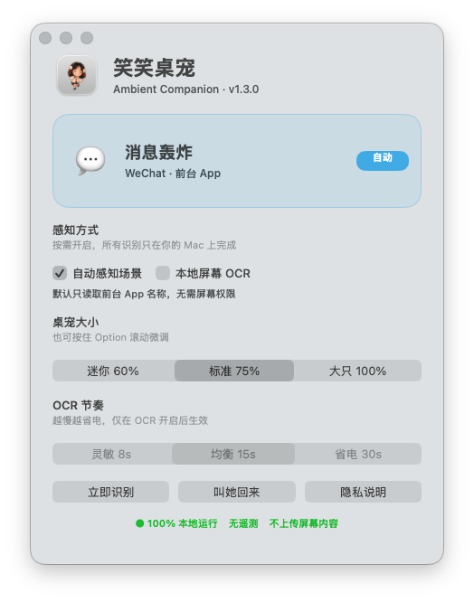

<div align="center">


# Rouyu Desktop Pet

**A native macOS companion that responds to your context and grows through daily interaction.**

[Download](../../releases/latest) · [简体中文](README.zh-CN.md) · [User guide (中文)](MANUAL.md) · [Contributing](CONTRIBUTING.md)


</div>

Rouyu (肉鱼) lives on your desktop without a Dock icon. She reacts to clicks, remembers her position and size, and changes between 23 scenes including coding, debugging, meetings, reading and late-night work. Four daily interactions build experience, a streak and five relationship levels. The app's interface and character dialogue are currently in Chinese.

<p align="center"></p>

## Features

- **A companion with progress:** pet, feed, praise and draw a daily fortune; complete all four for a daily reward.
- **Context awareness:** classify the foreground app locally. Optional OCR can inspect the frontmost window for additional scene cues.
- **Control and accessibility:** choose a size, adjust it with Option-scroll, enable click-through or quiet mode, and use keyboard navigation, VoiceOver and Reduce Motion.
- **Local by design:** no account, advertising, telemetry or network requests. Progress is stored in macOS preferences; screenshots and OCR text are not saved.
- **Optional Codex skin:** a separate 88-frame custom pet and matching interface and editor themes.

## Install

1. Download `SmilePet-v1.4.1-macos-universal.dmg` from the [latest release](../../releases/latest).
2. Drag the app to Applications. On first launch, Control-click it in Finder and choose **Open**.
3. Use the control center for interactions and settings; the menu-bar icon reopens it.

The documented release is ad-hoc signed and is not notarized by Apple. Download it from this repository and check `SHA256SUMS.txt` on the release page. See the [Chinese user guide](MANUAL.md) for installation and troubleshooting.

## Build and test

Requires macOS 13 or later and the Xcode command-line tools. The build produces a universal Apple Silicon and Intel app.

```bash
xcode-select --install
git clone https://github.com/flukier1016/smile-desktop-pet.git
cd smile-desktop-pet
./scripts/security-check.sh
./scripts/test.sh
./build.sh
open "肉鱼桌宠.app"
```

To package the documented release, run `./scripts/package-release.sh 1.4.1`. See the scripts and [contribution guide](CONTRIBUTING.md) before changing the build or assets.

## Privacy and permissions

By default, scene detection uses the frontmost app name and bundle identifier. OCR is off by default. When enabled, it requests screen-recording permission and uses Apple Vision to process the frontmost window in memory; images and recognized text are discarded. Disable it in the control center or revoke permission in System Settings. See [PRIVACY.md](PRIVACY.md) and [SECURITY.md](SECURITY.md).

## Optional Codex skin

The Codex skin is independent of the desktop app and uses supported configuration without modifying the official app bundle. The installer validates its inputs and backs up the existing configuration.

```bash
./scripts/install-codex-skin.sh
# To restore:
./scripts/uninstall-codex-skin.sh
```

See [CodexSkin/README.md](CodexSkin/README.md) for details.

## License and contributions

Source code, documentation and build tools are licensed under [MIT](LICENSE). Character artwork, icons, sprites and derived assets are **not** covered by MIT; see [ASSET_NOTICE.md](ASSET_NOTICE.md). Replace the artwork, app name and bundle identifier when making a code-based fork.

Bug reports and ideas are welcome in [Issues](../../issues). Please report security vulnerabilities through [private security advisories](../../security/advisories/new). See [CONTRIBUTING.md](CONTRIBUTING.md) for the development and asset rules.
